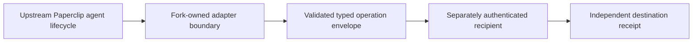

# Fork integration notes — bounded adapter interface

**Scope:** public `Christopher-Charman/paperclip` fork. This note concerns the code and public integration contract of this fork; it is **not** an operator runbook, account configuration or evidence of a deployed service.

## Upstream and lineage
Paperclip AI is the upstream agent-management application. Retain the upstream license, notices, branding and project documentation. The public fork includes an owner-specific `evenio-control` adapter under `server/src/adapters/evenio-control`. Evaluate changes against the upstream interface rather than assuming all upstream workers are authorised by an adapter.

## Bounded architecture

- An adapter declares capabilities and translates bounded requests. It is not itself an authority to execute arbitrary shell commands, publish content, access unrelated accounts or spend money.
- Treat identities, authentication, duplicate requests, transport failures and downstream action acceptance as distinct concerns.
- Preserve host secret material outside version control. Do not mirror private configuration or runtime transcripts into public examples.
- Keep compatibility tests, error handling and upstream API churn documented alongside adapter code.

## Verification gates
For source: adapter contract tests, normalized payloads, invalid operation/identity rejection, idempotency/replay and compilation against the pinned Paperclip revision. For deployment: require separate target-runtime authentication and independent effect readback. `FORK_SOURCE != ADAPTER_ACTIVATED != DESTINATION_ACCEPTED`.

**License:** retain upstream MIT `LICENSE` and attribution. This new documentation does not change the upstream project's endorsement or branding.
